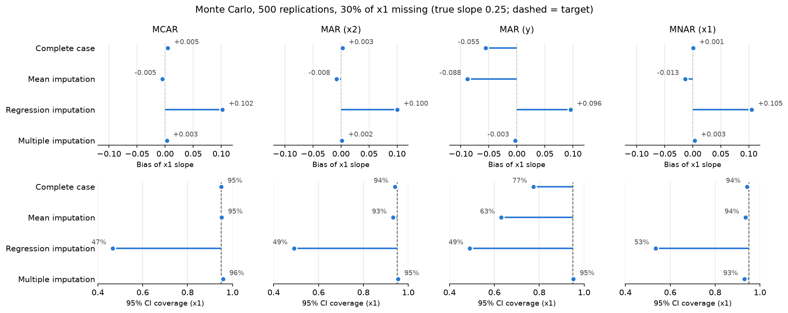
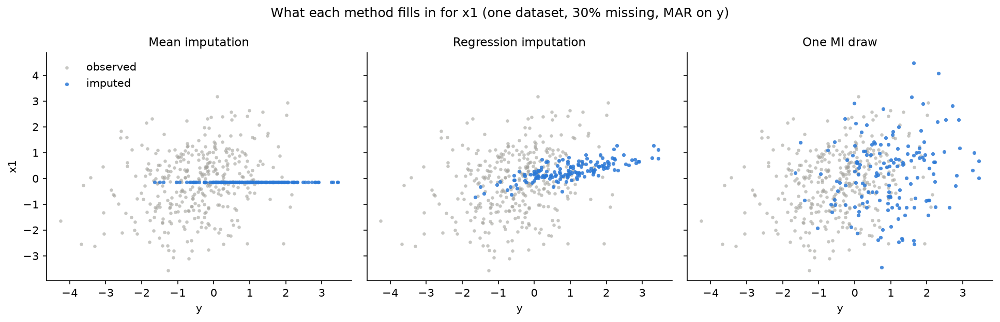

# Missing Data: Complete Case vs. Mean, Regression and Multiple Imputation

[](https://github.com/lukahere007/missing-data-imputation-analysis/actions/workflows/ci.yml)

[](LICENSE)

When a predictor in a linear regression has missing values, which way of handling them still gives unbiased slopes **and** honest confidence intervals, and how does that depend on *why* the values are missing (MCAR, MAR or MNAR)? In a 500-replication simulation, **multiple imputation** was the only method that stayed unbiased with about 95% CI coverage under all three MCAR/MAR settings. **Complete-case analysis** was just as good unless missingness depended on the outcome. **Mean imputation** biased the other predictor's slope. **Single regression imputation**, the method the first version of this notebook recommended, was the worst: about +40% bias and CIs that covered the truth only about half the time.

## Results

Simulated data: `(y, x1, x2)` multivariate normal, n = 500, true slopes 0.25 and 0.25. 30% of `x1` is deleted under four mechanisms, and `y ~ x1 + x2` is fitted with each method. 500 Monte Carlo replications; multiple imputation uses m = 20 imputations pooled with Rubin's rules.

**Bias of the `x1` slope (true value 0.25) / coverage of the nominal 95% CI**

| Method | MCAR | MAR on `x2` | MAR on `y` | MNAR on `x1` |
|---|---|---|---|---|
| Full data (reference) | +0.002 / 94% | +0.002 / 94% | +0.002 / 94% | +0.002 / 94% |
| Complete case | +0.005 / 95% | +0.003 / 94% | **−0.055 / 77%** | +0.001 / 94% |
| Mean imputation | −0.005 / 95% | −0.008 / 93% | **−0.088 / 63%** | −0.013 / 94% |
| Regression imputation (single) | **+0.102 / 47%** | **+0.100 / 49%** | **+0.096 / 49%** | **+0.105 / 53%** |
| Multiple imputation | +0.003 / 96% | +0.002 / 95% | −0.003 / 95% | +0.003 / 93% |

Bias and coverage for the fully observed `x2` slope are in the notebook and in [`results/monte_carlo_summary.csv`](results/monte_carlo_summary.csv). Mean imputation biases that slope by +0.027 to +0.050 (coverage 77–89%) under every mechanism.



What the methods actually fill in (one dataset, MAR on `y`). Mean imputation collapses the imputed values onto a single line. Regression imputation places them on a regression plane with no scatter, which inflates `corr(x1, y)` from 0.31 to 0.34. A multiple-imputation draw adds the residual noise back.



**Takeaways**

- **Complete case is unbiased whenever missingness doesn't depend on the outcome**, including the MAR-on-`x2` and MNAR-on-`x1` settings here. "MAR" does not by itself mean listwise deletion is biased. Its cost in those settings is wider intervals.
- **Single regression imputation understates uncertainty and overstates the effect**, because imputed values are treated as observed and carry no residual noise. Use stochastic, multiple imputation instead.
- **Multiple imputation relies on MAR.** Under MNAR it picked up a small bias in the `x2` slope (+0.018). MNAR calls for a sensitivity analysis, not a single "best" method.

## What changed from the first version

The first version deleted values of the **outcome** `y` and concluded that regression imputation was "far more reliable" than mean imputation. In that design, regression imputation just reproduces the complete-case fit: the imputed points lie on the complete-case regression plane, so the coefficients are identical. The notebook demonstrates this. The extra rows only shrink the standard errors (0.050 → 0.040 for `x1` in the demo), which makes the method look more precise than it is. The analysis now:

- deletes a **predictor**, which is the case where the choice of method matters;
- adds the **MNAR** mechanism that the old README mentioned but the notebook never implemented, plus a MAR-on-outcome mechanism;
- adds **multiple imputation** with Rubin's rules, cross-checked against scikit-learn's `IterativeImputer(sample_posterior=True)`;
- replaces the single simulated draw with a **500-replication Monte Carlo** reporting bias and CI coverage.

## Repository layout

```
├── Missing-Data-Imputation.ipynb   # the analysis, executed (start here)
├── simulation.py                   # data generation, missingness mechanisms, the four methods, Monte Carlo
├── tests/test_simulation.py        # unit tests (pytest)
├── figures/                        # figures written by the notebook
├── results/monte_carlo_summary.csv # full Monte Carlo summary table
├── requirements.txt
└── .github/workflows/ci.yml        # runs tests and executes the notebook on every push
```

## Run it

```bash
git clone https://github.com/lukahere007/missing-data-imputation-analysis.git
cd missing-data-imputation-analysis
python -m venv .venv && source .venv/bin/activate   # Windows: .venv\Scripts\activate
pip install -r requirements.txt

pytest                                    # unit tests
jupyter lab Missing-Data-Imputation.ipynb  # or run it headless:
jupyter nbconvert --to notebook --execute --inplace Missing-Data-Imputation.ipynb
```

The whole notebook runs in about 15 seconds. The Monte Carlo itself takes about 9 seconds. All randomness is seeded (`SEED = 2024`), so the numbers above reproduce exactly.

## Limitations

- **Only one data-generating process:** normal data, three variables, a correctly specified linear imputation model, missingness in a single variable. Skewed data, interactions and non-linear relationships, or missingness spread across several variables need a richer imputation model (e.g. chained equations with appropriate per-variable models).
- **Fixed selection strength.** MAR and MNAR use a rank-based rule (standardised driver + N(0, 1) noise). Stronger selection gives larger biases, weaker selection gives smaller ones.
- **Monte Carlo error:** with 500 replications, bias estimates carry a standard error of about 0.002–0.004 and coverage estimates about ±1 percentage point.

## Author

Luke Wamalwa · [MIT License](LICENSE)
